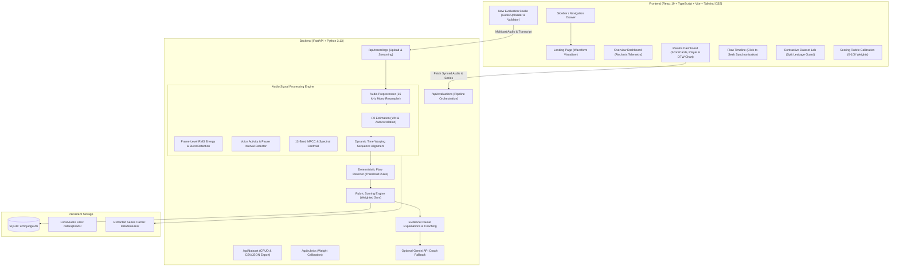

# EchoJudge AI — Explainable Speech Performance Evaluator

> **Tagline:** *"Every Word. Every Moment. Measurable Improvement."*  
> **Project:** Interdepartmental College Hackathon Showcase (Vervathon 2026)  
> **Core Focus:** Audio Signal Processing, Contrastive Benchmark Comparison, Temporal Delivery Flaw Grounding & Transparent Rubric Evaluation.

---

## 1. Project Overview

**EchoJudge AI** is a full-stack, scientific speech performance evaluation platform engineered for collegiate speech events (Interpretive Reading, Declamation, Extemporaneous Speaking, Persuasive Oratory, and General Public Speaking).

Unlike subjective human evaluation or opaque black-box classifiers, EchoJudge AI evaluates spoken performances by:
1. Comparing an evaluated participant's speech with an **Ideal Forensics Reference Recording** delivering the identical oratorical transcript.
2. Applying rigorous **audio signal processing** (Librosa, NumPy, SciPy) to extract pitch fundamental frequency ($F_0$), short-time RMS energy, speaking rate (WPM), articulation rate, silence intervals, and Mel-Frequency Cepstral Coefficients (MFCCs).
3. Aligning the acoustic sequences temporally using **Dynamic Time Warping (DTW)** and pause-aware word segmentation.
4. Detecting temporal flaws using deterministic, reproducible rules (rapid rushing tempo, hesitations, monotone pitch range, and acoustic volume bursts).
5. Calculating an explainable **0–100 rubric score** with transparent category weights.
6. Generating exact evidence-grounded coaching directives and actionable practice drills.

> **Forensic Ethics Disclosure:** Acoustic similarity does not automatically equal rhetorical excellence. Speakers possess naturally different voices, accents, and physiological vocal registers. EchoJudge AI evaluates rhetorical cadence, pacing consistency, pitch dynamic modulation, and pause appropriateness without penalizing natural accents or vocal identity.

---

## 2. System Architecture



---

## 3. Technology Stack

- **Frontend:** React 19, TypeScript, Vite, Tailwind CSS v4, Recharts, Lucide Icons, React Router v7.
- **Backend:** Python 3.13, FastAPI, Uvicorn, Pydantic v2, SQLite, HTTPX, Pytest.
- **Audio & Signal Processing:** Librosa, SoundFile, NumPy, SciPy (Signal processing, STFT, YIN $F_0$, RMS, DTW).
- **Optional AI Integration:** Google Gemini API (`gemini-1.5-flash`) for conversational coaching advice (operates 100% offline with zero cost if no key is configured).

---

## 4. Quickstart Guide (Local Setup)

### Prerequisites
- Python 3.10+ (Tested on Python 3.13)
- Node.js 18+ and npm (Tested on Node v24)
- Git

### 1. Clone & Set Up Python Virtual Environment

#### On Windows (PowerShell):
```powershell
# In project root: E:\Vervathon_project
python -m venv .venv
.venv\Scripts\Activate.ps1

# Install backend dependencies
pip install -r backend\requirements.txt
```

#### On macOS / Linux (Bash):
```bash
python3 -m venv .venv
source .venv/bin/activate
pip install -r backend/requirements.txt
```

---

### 2. Configure Environment Variables

A `.env.example` file is included in `backend/`:
```bash
cp backend/.env.example backend/.env
```
*(Optional) If you have a Gemini API key, add `GEMINI_API_KEY=your_key_here` to `backend/.env`. If left blank, EchoJudge AI runs 100% offline using deterministic forensic coaching templates with zero paid API requirements.*

---

### 3. Launch Backend Server

```powershell
# From project root (with venv activated):
python -m uvicorn app.main:app --host 127.0.0.1 --port 8000 --app-dir backend
```
*The backend server will automatically initialize SQLite database tables (`echojudge.db`) and seed the collegiate benchmark fixtures.*
- API Health Check: `http://127.0.0.1:8000/api/health`
- Interactive API Docs (Swagger): `http://127.0.0.1:8000/docs`

---

### 4. Launch Frontend Dev Server

In a new terminal window:
```powershell
cd frontend
npm install
npm run dev
```
Open **`http://127.0.0.1:5173/`** in your browser.

---

## 5. Hackathon Demonstration Walkthrough

To showcase the platform to judges in under 2 minutes:

1. **Landing Page:** Navigate to `http://127.0.0.1:5173/`. Observe the dual waveform visualization with the highlighted 2.4s delivery flaw.
2. **Launch Hackathon Demo:** Click **"Explore Hackathon Demo"** (or click "Launch Sample Demo" in the sidebar).
   - **Score Cards:** Inspect the overall score (**70.2 / 100**) and category breakdown.
   - **Dual Audio Player:** Press play on the Reference Recording (Lincoln Gettysburg Ideal benchmark) and Participant Recording.
   - **Recharts Alignment Chart:** Hover across the synchronized time series. Toggle between **F0 Pitch Contour (Hz)** and **RMS Loudness Energy**.
   - **Click-to-Seek Flaw Timeline:** Click the **"Excessive Pause (2.4s)"** flaw card. Notice the audio players instantly jump to 5.2s and the Recharts chart highlights the exact interval in red!
   - **Download Exports:** Click **"Flaws CSV"** or **"Summary JSON"** in the top-right header to verify authentic export data.
3. **Overview Dashboard:** Click **"Overview"** in the sidebar. See the live SQLite aggregations: Total Evaluations, Average Score (70.2), Flaws Identified (3), and distribution charts.
4. **Contrastive Dataset Lab:** Click **"Dataset Lab"** in the sidebar. Inspect the train, validation, and test split assignments with strict speech-leakage prevention. Export the dataset as CSV or JSON.
5. **Run a New Evaluation:** Click **"New Evaluation"**, click **"Autofill Collegiate Sample Form"**, select your recordings, and hit **"Analyze Speech"** to watch the real-time signal processing execution stages!

---

## 6. Running Automated Tests

Run the complete backend signal processing and scoring test suite:
```powershell
.venv\Scripts\pytest -o pythonpath=backend backend\tests -v
```
All 5 comprehensive unit tests will execute:
- `test_audio_preprocessing_validation`: Validates 16 kHz resampler, mono conversion, and duration calculations.
- `test_feature_extraction_pitch_and_pauses`: Tests YIN autocorrelation pitch tracking and energy threshold pause detection.
- `test_dtw_sequence_alignment`: Tests Sakoe-Chiba constrained Dynamic Time Warping.
- `test_flaw_detection_and_merging`: Validates deterministic flaw detection rules and interval merging.
- `test_rubric_scoring_calculation`: Tests 0–100 weighted rubric formula calculations.

---

## 7. Forensic Rules & Scoring Methodology

| Category | Default Weight | Acoustic Metric & Rule |
| :--- | :--- | :--- |
| **Pacing (WPM)** | 25% | Flags delivery if participant WPM exceeds or lags reference by > 25%. |
| **Pauses & Fluency** | 20% | Flags silences exceeding 1.80s as awkward hesitations or memory lapses. |
| **Vocal Variation (Pitch)** | 20% | Flags monotone pitch range if $F_0$ dynamic spread is < 35 Hz. |
| **Loudness Consistency** | 15% | Flags abrupt short-time RMS energy bursts (+10 dB) such as microphone pops. |
| **Spectral Clarity** | 10% | Evaluates 13-band MFCC envelope distance and spectral centroid brightness. |
| **Rhetorical Emphasis** | 10% | Balanced dynamic score across operative climax assertions. |

---

## 8. Privacy & Data Retention Notes

- **Zero Remote Dependencies:** Core evaluation runs 100% locally on your machine with zero external API calls.
- **Local Persistence:** Audio uploads and feature representations reside strictly on local storage (`backend/data/`).
- **Data Cleanup:** You can wipe local audio files anytime via the **Settings & Telemetry** page.

---

## 9. License

Developed for the Interdepartmental College Hackathon (Vervathon 2026). Open source for educational and academic forensics research.
